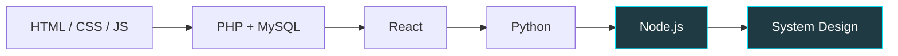

<div align="center">


<br/>


<br/><br/>

**[👨‍💻 About](#-about-me) • [🚀 Projects](#-featured-projects) • [🗺️ Roadmap](#️-my-learning-roadmap) • [📊 Stats](#-github-stats) • [📬 Contact](#-connect-with-me)**

</div>

---

## 🧑‍💻 About Me


```ts
const shivam = {
  name: "Shivam Chauhan",
  role: "Full-Stack Developer",
  location: "Mumbai, India 🇮🇳",
  education: "B.Voc Software Development",
  skills: ["React", "PHP", "Python", "MySQL"],
  currentlyLearning: ["Node.js", "System Design"],
  openTo: ["Internships", "Freelance", "Collaboration"],
  mindset: "Code. Break. Fix. Repeat 🚀"
};
```

✨ I build real-world scalable projects
⚡ Focused on frontend + backend
☕ Coffee + Code = Productivity

<details>
<summary><b>🎲 Click for fun facts about me</b></summary>
<br/>

- 🌙 I do my best debugging after midnight
- 🐛 I have broken production at least once (and fixed it)
- 🎧 Lo-fi beats are my default coding soundtrack
- 🤖 I built my own voice assistant just because I could

</details>

---

## 🚀 Featured Projects

> 👇 Click any card to open the repo, or expand a project for details.

<div align="center">

<a href="https://github.com/ShivamDev11/Machine-Rentals">
  
</a>
<a href="https://github.com/ShivamDev11/Jarvis-AI-Assistant">
  
</a>
<a href="https://github.com/ShivamDev11/Internship-Tracker">
  
</a>

</div>

<details>
<summary><b>🛒 Machine Rentals (E-Commerce)</b></summary>
<br/>

- PHP + MySQL full-stack application
- Admin dashboard with full CRUD
- **Stack:** `PHP` `MySQL` `Bootstrap` `JavaScript`

</details>

<details>
<summary><b>🤖 Jarvis AI Assistant</b></summary>
<br/>

- Python voice assistant
- Automation + speech recognition
- **Stack:** `Python` `SpeechRecognition` `pyttsx3`

</details>

<details>
<summary><b>📊 Internship Tracker</b></summary>
<br/>

- Filter system (Flipkart style)
- Bootstrap + PHP backend
- **Stack:** `PHP` `Bootstrap` `MySQL`

</details>

---

## 🗺️ My Learning Roadmap



---

## 🛠️ Tech Stack

<div align="center">

<a href="https://github.com/ShivamDev11?tab=repositories&q=&language=javascript"></a>

</div>

---

## 📊 GitHub Stats

<div align="center">


<br/>


<br/>


<br/>


</div>

---

## 🎮 Live footage of me fighting bugs at 2 AM

<div align="center">


</div>

---

## 🧠 Developer Philosophy

<div align="center">


</div>

> “First make it work. Then make it better. Then make it fast.”

---

## 🎯 Current Focus

| Focus | Status |
|-------|--------|
| 🔥 Full-Stack Projects |  |
| ⚡ System Design |  |
| 📦 Backend Optimization |  |
| 💼 Internship Preparation |  |

---

## 📬 Connect With Me

<div align="center">

[](https://instagram.com/Samm_._._11)
[](https://linkedin.com/in/shivam-chauhan-2bb027353)
[](mailto:shivamchauhan1106@gmail.com)

<br/>

⭐ Star my repositories if you like my work
🤝 Let's build something amazing

</div>

<div align="center">


</div>
